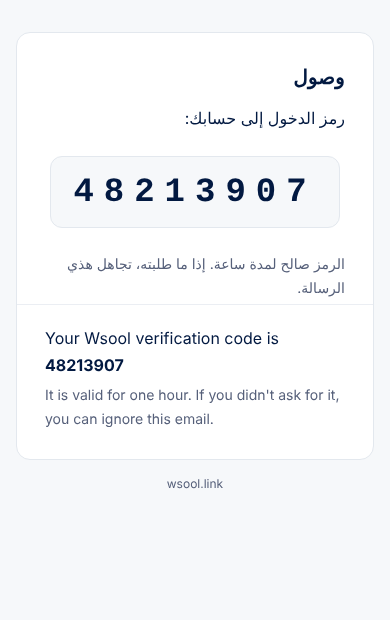

# رسالة رمز الدخول (Supabase)

> جهّزها Claude (أكتوبر 2026). القالب نفسه يتحط في **قالبين** في Supabase:
> **Authentication → Emails → Templates → Magic Link** و **Confirm signup**.
> بعد التعديل اضغط **Save** في كل واحد.

## لماذا هذا الشكل
- **الرمز أول شي في العنوان، ومعه عبارة «verification code».** Gmail يتعرّف على رسائل الرموز من العنوان والنص،
  ويعرض بطاقة «Code requested» مع زر **Copy code** (هذي ميزة من Gmail نفسه، مو من المرسل). وآيفون يقترح الرمز فوق
  لوحة المفاتيح، لأن خانة الرمز في الموقع والتطبيق معلّمة «one-time-code».
- **الرمز كبير بخط ثابت ومسافات بين الأرقام** (مثل رسالة Tap)، سهل القراءة والنسخ اليدوي.
- بدون صور أو روابط، عشان ما تروح للـ Spam، وتنقرأ في الوضع الداكن.



## العنوان (Subject)
```
{{ .Token }} is your Wsool verification code | رمز الدخول إلى وصول
```

## النص (Message body)
```html
<!doctype html>
<html lang="ar" dir="rtl">
<body style="margin:0;padding:0;background:#F6F8FA;">
<table role="presentation" width="100%" cellpadding="0" cellspacing="0" style="background:#F6F8FA;">
<tr><td align="center" style="padding:32px 16px;">
<table role="presentation" width="100%" cellpadding="0" cellspacing="0" style="max-width:480px;background:#ffffff;border:1px solid #E3E8EE;border-radius:14px;">
<tr><td style="padding:32px 28px 8px 28px;font-family:-apple-system,BlinkMacSystemFont,'Segoe UI',Tahoma,Arial,sans-serif;color:#021941;text-align:right;" dir="rtl">
  <div style="font-size:20px;font-weight:700;margin:0 0 4px 0;">وصول</div>
  <div style="font-size:16px;line-height:1.7;margin:16px 0 0 0;">رمز الدخول إلى حسابك:</div>
</td></tr>
<tr><td align="center" style="padding:16px 28px;">
  <div dir="ltr" style="display:inline-block;background:#F6F8FA;border:1px solid #E3E8EE;border-radius:12px;padding:16px 22px;font-family:'SF Mono',Menlo,Consolas,'Courier New',monospace;font-size:34px;font-weight:700;letter-spacing:10px;color:#021941;">{{ .Token }}</div>
</td></tr>
<tr><td style="padding:8px 28px 4px 28px;font-family:-apple-system,BlinkMacSystemFont,'Segoe UI',Tahoma,Arial,sans-serif;color:#56607A;font-size:14px;line-height:1.7;text-align:right;" dir="rtl">
  الرمز صالح لمدة ساعة. إذا ما طلبته، تجاهل هذي الرسالة.
</td></tr>
<tr><td style="padding:20px 28px 28px 28px;border-top:1px solid #EBEEF3;font-family:-apple-system,BlinkMacSystemFont,'Segoe UI',Tahoma,Arial,sans-serif;color:#56607A;font-size:14px;line-height:1.7;text-align:left;" dir="ltr">
  <div style="color:#021941;font-size:16px;margin:0 0 4px 0;">Your Wsool verification code is <b dir="ltr">{{ .Token }}</b></div>
  It is valid for one hour. If you didn't ask for it, you can ignore this email.
</td></tr>
</table>
<div style="font-family:-apple-system,BlinkMacSystemFont,'Segoe UI',Tahoma,Arial,sans-serif;color:#56607A;font-size:12px;padding:16px 0 0 0;">wsool.link</div>
</td></tr>
</table>
</body>
</html>
```

> ملاحظة: مدة الصلاحية في النص (ساعة) تطابق إعداد Supabase الافتراضي **Email OTP Expiration = 3600**.
> لو غيّرته في Supabase، عدّل الجملة.

> **طول الرمز:** 6 أرقام (المالك، 31 أكتوبر 2026، كان 8): Supabase ← Sign In / Providers ← Email ← Email OTP Length.
> الموقع والتطبيق يقبلون من 6 إلى 10 أرقام. اقتراح الرمز فوق لوحة مفاتيح الآيفون شغّال. زر Copy code في Gmail يقرره Gmail
> نفسه، وما ظهر للحين (غالباً لأن المرسل جديد عليه).
